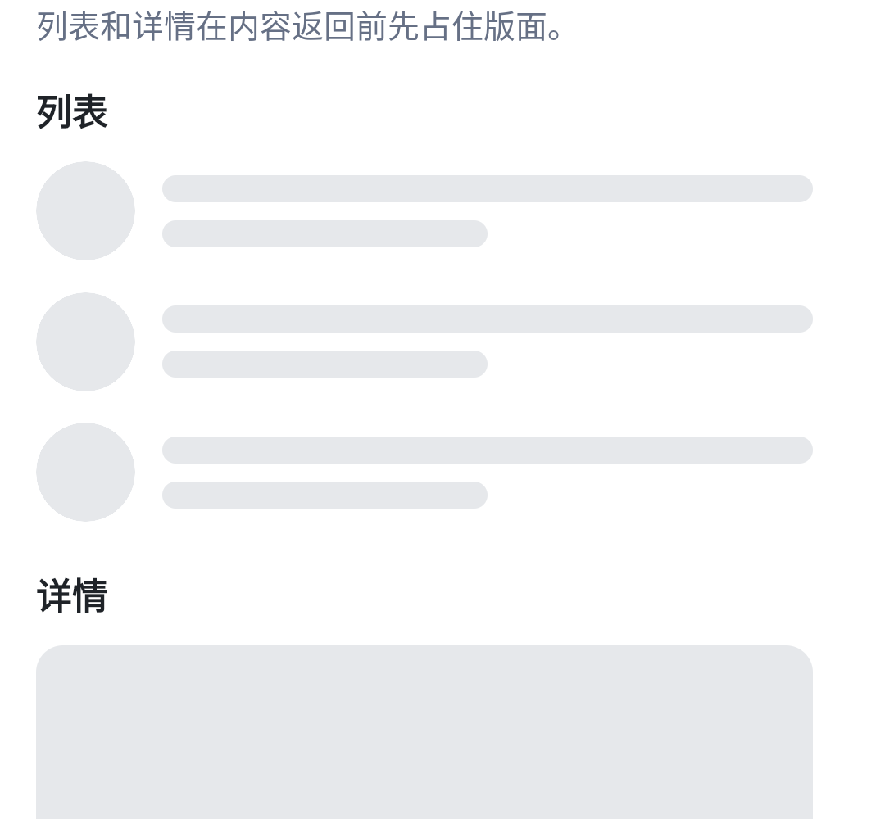
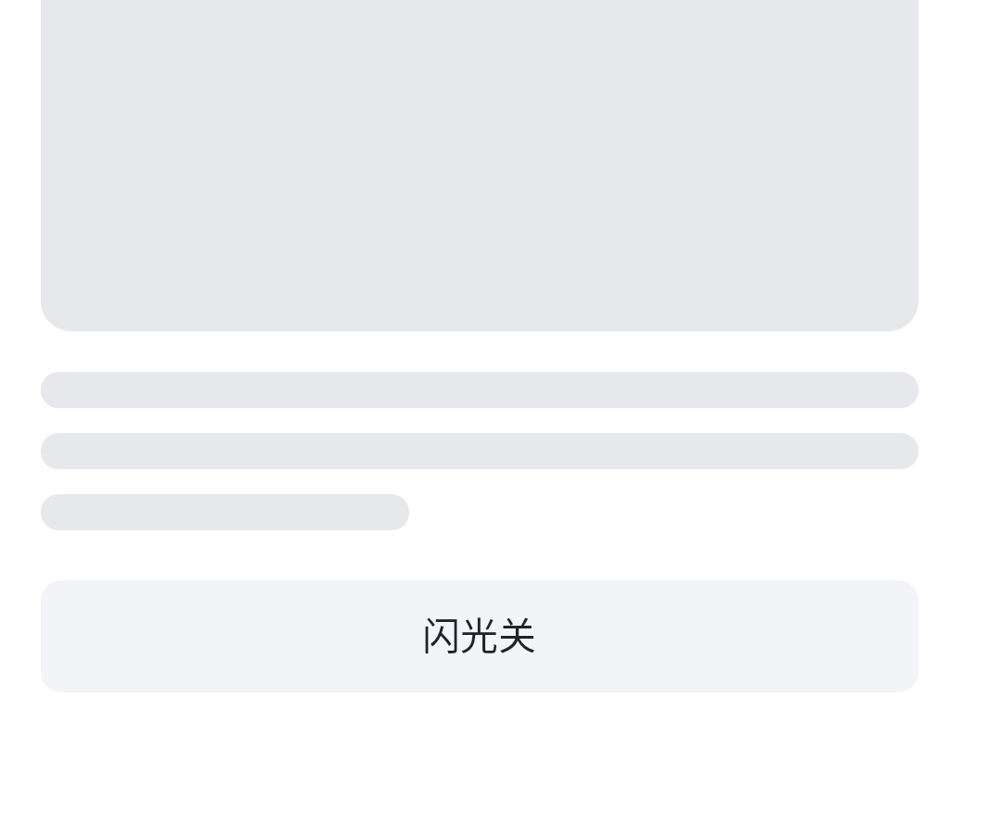

# KuiklySkeleton

Kuikly 骨架占位。自研 DSL 画列表和详情的灰色占位块，Compose DSL 提供同名薄封装。

作者：[@FooWrites](https://github.com/FooWrites)

## 效果

自研 DSL · Android

<table>
  <tr>
    <td></td>
    <td></td>
  </tr>
  <tr>
    <td align="center">列表</td>
    <td align="center">详情</td>
  </tr>
</table>

## 安装

```kotlin
repositories {
    mavenCentral()
    maven("https://jitpack.io")
}
```

自研 DSL：

```kotlin
implementation("com.github.FooWrites.KuiklySkeleton:skeleton:v0.1.0")
```

Compose DSL：

```kotlin
implementation("com.github.FooWrites.KuiklySkeleton:skeleton-compose:v0.1.0")
```

`skeleton-compose` 已传递依赖 `skeleton`。本库基于 Kotlin 2.1.21 / Kuikly 2.4.2-2.0.21 构建。JitPack 发布 `:skeleton` 与 `:skeleton-compose`。

## 自研 DSL

```kotlin
SkeletonCircle {
    attr {
        size(44f)
        baseColor(Color(0xFFE6E8EBL))
        animated(false)
    }
}

SkeletonText {
    attr {
        lines(3)
        lineHeight(14f)
        lineSpacing(10f)
        lastLineWidthRatio(0.42f)
        animated(false)
    }
}

SkeletonBox {
    attr {
        height(160f)
        cornerRadius(12f)
        animated(false)
    }
}
```

颜色用 `com.tencent.kuikly.core.base.Color`。宽高沿用容器的 `width` / `height`；圆形用 `size`。文本条最多 12 行。`animated(false)` 为默认静态占位。

## Compose DSL

```kotlin
SkeletonCircle(
    modifier = Modifier.width(44.dp).height(44.dp),
    size = 44f,
    animated = false,
)

SkeletonText(
    modifier = Modifier.fillMaxWidth(),
    lines = 3,
    lineHeight = 14f,
    lastLineWidthRatio = 0.42f,
    animated = false,
)

SkeletonBox(
    modifier = Modifier.fillMaxWidth().height(160.dp),
    cornerRadius = 12f,
    animated = false,
)
```

演示页 `skeleton_compose_demo`。

## 能力边界

占位形状是圆角矩形、文本条、圆形。库内不提供加载遮罩或转圈。

组件使用 Kuikly View。`animated` 默认 `false`，静态占位可供 sDynamic 与 JS 使用，动画路径不依赖协程。

`animated(true)` 用属性动画做透明度脉冲（1 与 0.45）。sDynamic 与 JS 的支持路径是默认静态占位。

## 许可

Apache License 2.0

Copyright (c) 2026 FooWrites
